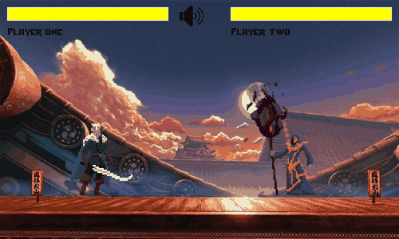
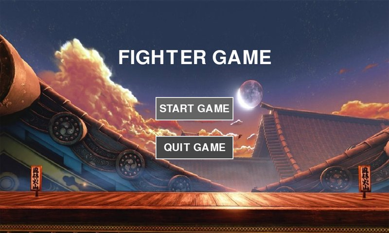
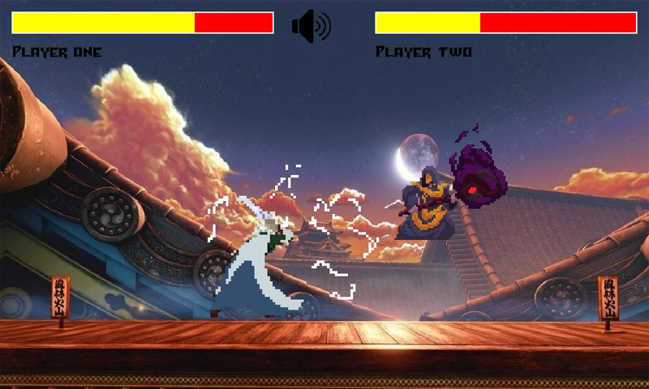
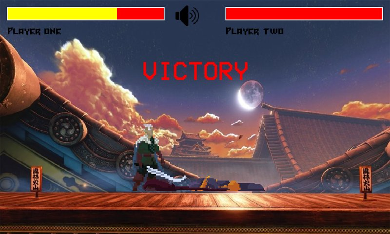

# ⚔️ Fighter Game

A 2D local multiplayer fighting game built with **Python** and **Pygame**, where two players battle using different characters, attacks, and abilities.

## 🎮 Game Preview

<p align="center">
  
</p>

## ✨ Features

- **Local Multiplayer:** Two players can compete on the same computer.
- **Two Unique Characters:** A Warrior and a Wizard, each with their own sprites, attacks, and sounds.
- **Combat System:** Each fighter has two different attacks with cooldowns.
- **Character Animations:** Idle, running, jumping, attacking, getting hit, and death animations.
- **Physics:** Gravity, jumping, screen boundaries, and automatic facing toward the opponent.
- **Health Bars:** Track each fighter's remaining health.
- **Round System:** Countdown, victory screen, and automatic round reset.
- **Start Menu and Sound Toggle:** A simple menu, plus an in-game mute button.

## 🕹️ Controls

| Action | Player 1 – Warrior | Player 2 – Wizard |
|---|---|---|
| Move Left | A | ← |
| Move Right | D | → |
| Jump | W | ↑ |
| Attack 1 | R | Num 1 |
| Attack 2 | T | Num 2 |

**Mouse:** click the menu buttons to start or quit, and click the speaker icon at the top of the screen to mute or unmute sound effects.

## 🖼️ Screenshots

<p align="center">
  
  
</p>

<p align="center">
  
</p>

## 🛠️ Technologies

- **Python**
- **Pygame**

## 🚀 Getting Started

### Prerequisites

- Python 3.8 or newer
- pip

### Installation

1. Clone the repository:

   ```bash
   git clone https://github.com/Nada-Seyam/Fighter-Game.git
   ```

2. Navigate to the project directory:

   ```bash
   cd Fighter-Game
   ```

3. Install the dependencies:

   ```bash
   pip install -r requirements.txt
   ```

4. Run the game from the project root folder (assets are loaded using relative paths):

   ```bash
   python game.py
   ```

## 📁 Project Structure

```text
Fighter-Game/
│
├── assets/
│   ├── audio/
│   ├── fonts/
│   ├── Background/
│   ├── Items/
│   ├── images/
│   │   ├── warrior/
│   │   ├── wizard/
│   │   ├── background/
│   │   └── icons/
│   └── screenshots/
│       ├── menu.jpg
│       ├── gameplay.jpg
│       ├── gameplay.gif
│       └── victory.jpg
│
├── game.py
├── requirements.txt
├── Documentation.pdf
├── Documentation.docx
└── README.md
```

## 🏗️ Code Structure

The project is organized around the following main components:

- **`Button`:** Handles menu buttons and user interactions.
- **`SoundButton`:** Controls the game's sound settings.
- **`Fighter`:** Manages player movement, animations, health, and attacks.
- **`show_start_menu()`:** Displays the main menu.
- **`main()`:** Runs the main game loop and manages gameplay.

## ⚙️ Game Configuration

| Setting | Value |
|---|---:|
| Screen Resolution | 1000 × 600 |
| Frames Per Second | 60 |
| Player Speed | 10 |
| Gravity | 2 |
| Jump Strength | -30 |
| Attack Damage | 10 |
| Attack Cooldown | 20 frames |
| Round-End Delay | 2000 ms |

## 🔮 Future Improvements

- Add a scoreboard to display match results.
- Add adjustable music and sound-effect volume.
- Add pause, rematch, and return-to-menu options.
- Add game controller support.
